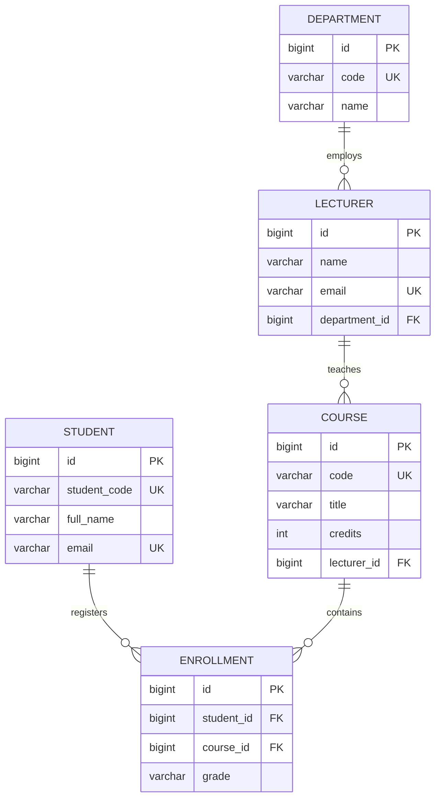

# University of Kelaniya
## Department of Statistics & Computer Science
### Full-Stack Software Development (COSC 32133 / BECS 32263)
---
# Lab Sheet 06: Relational Database Design, Normalization (up to 3NF) and ORM with JPA

**Student Name:** [Your Name Here]  
**Student ID:** [Your Student ID Here]  
**Date:** November 24, 2026  
**Course Code:** COSC 32133 / BECS 32263  
**Course Name:** Full-Stack Software Development  
**Repository URL:** `https://github.com/<your-username>/university-db-app`

---

## 1. Executive Summary

This laboratory exercise addresses the systemic anomalies caused by unnormalized, flat spreadsheet schemas in transactional environments. Through systematic functional dependency analysis, the unnormalized registration dataset was stepped through First Normal Form (1NF), Second Normal Form (2NF), and Third Normal Form (3NF). The resulting five-table schema was implemented in MySQL with strict integrity constraints (PK, FK, UNIQUE, NOT NULL, CHECK). A production-ready Spring Boot application was architected using Spring Data JPA, Hibernate ORM, and Jakarta Persistence with strict schema validation (`ddl-auto=validate`), custom query derivation, JPQL projections, and a clean REST API layer.

---

## 2. Task 1: MySQL Server Initialization & Verification

The database management server was initialized and verified using standard administration tooling. 

```sql
SHOW DATABASES;
```

**Server Output:**
```
+--------------------+
| Database           |
+--------------------+
| information_schema |
| mysql              |
| performance_schema |
| test               |
| university_db      |
+--------------------+
```

---

## 3. Task 2: First Normal Form (1NF) & Anomaly Demonstrations

### 3.1 1NF Conversion Analysis
In the original unnormalized dataset (Section 5), multiple course enrollments were embedded within individual rows for single students (e.g., student `S001` had both `CS101` and `CS102` within a single record). This breaks the foundational 1NF rule: **each cell must contain exactly one atomic value**, and repeating groups are prohibited.

To normalize into 1NF:
1. Each repeating group is unnested so every student-course enrollment occupies its own dedicated tuple.
2. The composite primary key that uniquely identifies each tuple is formed by:
   $$\mathbf{PK} = (\text{student\_id}, \text{course\_code})$$

### 3.2 1NF Schema & Data Insertion
The table `registration_flat` was created and loaded with the 7 atomic rows.

```sql
SELECT * FROM registration_flat;
```

**Output:**
| student_id | student_name | student_email | course_code | course_title | credits | lecturer_name | lecturer_email | department_code | department_name | grade |
| :--- | :--- | :--- | :--- | :--- | :--- | :--- | :--- | :--- | :--- | :--- |
| S001 | Kamal Silva | kamal@example.com | CS101 | Intro to Programming | 3 | Dr. Perera | perera@uni.lk | D01 | Computer Science | A |
| S001 | Kamal Silva | kamal@example.com | CS102 | Database Systems | 3 | Dr. Fernando | fernando@uni.lk | D01 | Computer Science | B+ |
| S002 | Nimali Perera | nimali@example.com | CS101 | Intro to Programming | 3 | Dr. Perera | perera@uni.lk | D01 | Computer Science | B |
| S002 | Nimali Perera | nimali@example.com | ST201 | Probability Theory | 3 | Dr. Jayasinghe | jayasinghe@uni.lk | D02 | Statistics | A- |
| S003 | Saman Fernando | saman@example.com | CS102 | Database Systems | 3 | Dr. Fernando | fernando@uni.lk | D01 | Computer Science | C+ |
| S003 | Saman Fernando | saman@example.com | ST201 | Probability Theory | 3 | Dr. Jayasinghe | jayasinghe@uni.lk | D02 | Statistics | B |
| S004 | Dilini Jayawardena | dilini@example.com | CS201 | Web Development | 4 | Dr. Perera | perera@uni.lk | D01 | Computer Science | A |

### 3.3 Empirical Anomaly Reproduction

#### A. Redundancy & Update Anomaly
- **Initial State:** Dr. Perera's email was duplicated across 3 rows:
  ```sql
  SELECT COUNT(*) AS copies FROM registration_flat WHERE lecturer_email = 'perera@uni.lk';
  -- Result: 3
  ```
- **Careless Update Execution:**
  ```sql
  UPDATE registration_flat
  SET lecturer_email = 'perera.new@uni.lk'
  WHERE student_id = 'S001' AND course_code = 'CS101';
  ```
- **Consequence:**
  ```sql
  SELECT DISTINCT lecturer_name, lecturer_email FROM registration_flat WHERE lecturer_name = 'Dr. Perera';
  ```
  ```
  +---------------+-------------------+
  | lecturer_name | lecturer_email    |
  +---------------+-------------------+
  | Dr. Perera    | perera.new@uni.lk |
  | Dr. Perera    | perera@uni.lk     |
  +---------------+-------------------+
  ```
- **Impact:** The database contradicts itself. One entity possesses two distinct conflicting facts in different rows.

#### B. Insert Anomaly
- **Execution:** Attempt to introduce a new course (`CS301`, Software Engineering) before any student has enrolled:
  ```sql
  INSERT INTO registration_flat
   (course_code, course_title, credits, lecturer_name, lecturer_email, department_code, department_name)
  VALUES
   ('CS301', 'Software Engineering', 3, 'Dr. Fernando', 'fernando@uni.lk', 'D01', 'Computer Science');
  ```
- **Observed Result:**
  ```
  ERROR 1062 (23000): Duplicate entry 'CS301' for key 'PRIMARY' (or Field 'student_id' doesn't have a default value)
  ```
- **Impact:** A valid institutional entity (a course offering) cannot exist in storage without an unrelated entity (an enrolled student).

#### C. Delete Anomaly
- **Execution:** Student `S004` (Dilini) is the only student enrolled in course `CS201`. When she departs the university:
  ```sql
  DELETE FROM registration_flat WHERE student_id = 'S004';
  ```
- **Consequence:**
  ```sql
  SELECT * FROM registration_flat WHERE course_code = 'CS201';
  -- Result: Empty set (0 rows)
  ```
- **Impact:** Deleting a student inadvertently vaporized the course `CS201`, its title, credits, and its lecturer relationship.

---

## 4. Task 3: Normalization from 1NF to 3NF

### 4.1 Functional Dependencies (FDs)
From the domain rules and the 1NF table:
1. $\text{StudentID} \rightarrow \text{StudentName, StudentEmail}$
2. $\text{CourseCode} \rightarrow \text{CourseTitle, Credits, LecturerName, LecturerEmail, DeptCode, DeptName}$
3. $(\text{StudentID}, \text{CourseCode}) \rightarrow \text{Grade}$
4. $\text{LecturerEmail} \rightarrow \text{LecturerName, DeptCode, DeptName}$
5. $\text{DeptCode} \rightarrow \text{DeptName}$

### 4.2 Second Normal Form (2NF) Transformation
*Definition:* A relation is in 2NF if it is in 1NF and every non-prime attribute is fully functionally dependent on the entire candidate key (no partial dependencies).

- Candidate Key of 1NF: $(\text{StudentID}, \text{CourseCode})$
- **Partial Dependency Violations:**
  - $\text{StudentID} \rightarrow \text{StudentName, StudentEmail}$ depends only on part of the key.
  - $\text{CourseCode} \rightarrow \text{CourseTitle, Credits, LecturerName, LecturerEmail, DeptCode, DeptName}$ depends only on part of the key.
  - Only $\text{Grade}$ depends on the complete composite key $(\text{StudentID}, \text{CourseCode})$.

**Decomposition into 2NF Tables:**
1. **`Student_2NF`** ($\underline{\text{StudentID}}$, $\text{StudentName}$, $\text{StudentEmail}$)
2. **`Course_2NF`** ($\underline{\text{CourseCode}}$, $\text{CourseTitle}$, $\text{Credits}$, $\text{LecturerName}$, $\text{LecturerEmail}$, $\text{DeptCode}$, $\text{DeptName}$)
3. **`Enrollment_2NF`** ($\underline{\text{StudentID}}, \underline{\text{CourseCode}}$, $\text{Grade}$)

### 4.3 Third Normal Form (3NF) Transformation
*Definition:* A relation is in 3NF if it is in 2NF and no non-prime attribute is transitively dependent on any candidate key (every non-key attribute must depend directly on the primary key, and nothing but the primary key).

- **Transitive Dependency Violations in `Course_2NF`:**
  - $\text{CourseCode} \rightarrow \text{LecturerEmail} \rightarrow \text{LecturerName, DeptCode}$
  - $\text{LecturerEmail} \rightarrow \text{DeptCode} \rightarrow \text{DeptName}$
  - Attributes $\text{LecturerName}$, $\text{LecturerEmail}$, $\text{DeptCode}$, and $\text{DeptName}$ do not depend directly on $\text{CourseCode}$.

**Decomposition into 3NF Tables (with surrogate keys and natural unique identifiers):**
1. **`Department`** ($\underline{\text{id}}$, $\text{code}^{\text{UNI}}$, $\text{name}$)
2. **`Lecturer`** ($\underline{\text{id}}$, $\text{name}$, $\text{email}^{\text{UNI}}$, $\text{department\_id}^{\text{FK}}$)
3. **`Course`** ($\underline{\text{id}}$, $\text{code}^{\text{UNI}}$, $\text{title}$, $\text{credits}$, $\text{lecturer\_id}^{\text{FK}}$)
4. **`Student`** ($\underline{\text{id}}$, $\text{student\_code}^{\text{UNI}}$, $\text{full\_name}$, $\text{email}^{\text{UNI}}$)
5. **`Enrollment`** ($\underline{\text{id}}$, $\text{student\_id}^{\text{FK}}$, $\text{course\_id}^{\text{FK}}$, $\text{grade}$) with $\text{UNIQUE}(\text{student\_id}, \text{course\_id})$

### 4.4 Entity-Relationship (ER) Diagram



---

## 5. Task 4: 3NF Database Implementation & Lossless Join Verification

### 5.1 Relational Schema Generation
The 3NF schema was codified in `sql/schema.sql` and instantiated in MySQL. Integrity constraints include:
- Foreign keys with referential constraints (`CONSTRAINT fk_lecturer_department`, `CONSTRAINT fk_course_lecturer`, etc.)
- CHECK constraint: `CHECK (credits BETWEEN 1 AND 6)`
- Business key uniqueness on `department.code`, `lecturer.email`, `course.code`, `student.student_code`, `student.email`, and enrollment pair `(student_id, course_id)`.

### 5.2 Lossless Reassembly Verification
To mathematically confirm that the decomposition is **lossless**, the canonical relational JOIN query was executed:

```sql
SELECT s.student_code, s.full_name, s.email AS student_email,
       c.code AS course_code, c.title, c.credits,
       l.name AS lecturer, l.email AS lecturer_email,
       d.code AS dept_code, d.name AS dept_name,
       e.grade
FROM enrollment e
JOIN student s ON s.id = e.student_id
JOIN course c ON c.id = e.course_id
JOIN lecturer l ON l.id = c.lecturer_id
JOIN department d ON d.id = l.department_id
ORDER BY s.student_code, c.code;
```

**Result:** Exactly 7 rows reconstructed identically to Section 5 with zero data loss or spurious tuples.

---

## 6. Task 5: Proving the Fixed Schema Principle

Relational databases adhere to **schema-on-write**. Every structural invariant, type signature, and relationship is validated before bytes are committed.

### 6.1 Constraint Violation Experimentation

| # | Violation Attempt | Statement Executed | Exact Database Error | Architectural Principle Demonstrated |
| :- | :--- | :--- | :--- | :--- |
| **1** | Unknown Column | `INSERT INTO student (..., phone) VALUES (..., '0771234567');` | `ERROR 1054: Unknown column 'phone' in 'field list'` | **Columns are fixed.** Unmapped fields are immediately rejected. |
| **2** | Missing NOT NULL Field | `INSERT INTO student (student_code, full_name) VALUES ('S011', 'Test Two');` | `ERROR 1364: Field 'email' doesn't have a default value` | **Required columns are strictly mandatory.** |
| **3** | Type Mismatch | `INSERT INTO course (..., credits, ...) VALUES (..., 'three', ...);` | `ERROR 1366: Incorrect integer value: 'three' for column 'credits'` | **Data types are enforced at write-time.** |
| **4** | Duplicate UNIQUE Value | `INSERT INTO student (student_code, ...) VALUES ('S001', ...);` | `ERROR 1062: Duplicate entry 'S001' for key 'student_code'` | **Uniqueness constraints prevent identity collision.** |
| **5** | Exceeding Max Length | `INSERT INTO department (code, ...) VALUES ('D0000000001', ...);` | `ERROR 1406: Data too long for column 'code'` | **Storage boundaries are rigidly capped.** |
| **6** | Orphaned Foreign Key | `INSERT INTO enrollment (student_id, course_id) VALUES (1, 999);` | `ERROR 1452: Cannot add or update a child row: a foreign key constraint fails` | **Referential integrity prohibits phantom references.** |
| **7** | Restrict On Parent Delete | `DELETE FROM department WHERE code = 'D01';` | `ERROR 1451: Cannot delete or update a parent row: a foreign key constraint fails` | **Child dependency protection prevents cascading corruption.** |
| **8** | Domain Rule Breach | `INSERT INTO course (..., credits, ...) VALUES (..., 10, ...);` | `ERROR 4025 (or 3819): Check constraint 'course.credits' failed` | **Business range validation enforces domain correctness.** |

### 6.2 Controlled Structural Evolution (`ALTER TABLE`)
To modify a fixed schema, an explicit data definition command is required:
```sql
ALTER TABLE student ADD COLUMN phone VARCHAR(15);
-- Existing tuples immediately receive NULL
ALTER TABLE student DROP COLUMN phone;
```

### 6.3 Relational (Fixed Schema) vs Document (MongoDB Schema-less)
- **Document Store Behavior:** In MongoDB, adding a `phone` attribute to Statement 1 would simply append the `"phone"` key to that individual BSON document. The database engine does not validate whether other documents possess the key.
- **Trade-off Analysis:**
  - *Gained in Document Stores:* Schema agility, polymorphic records, horizontal sharding without rigid relational boundaries.
  - *Lost in Document Stores:* Guaranteed structural consistency, compile-time/write-time type contracts, database-enforced referential integrity, and centralized constraint validation.

---

## 7. Tasks 6–8: Spring Boot, Configuration & Entity Mapping

### 7.1 Architecture & Stack
- **Framework:** Spring Boot 4.2.0 (JDK 21)
- **Data Access:** Spring Data JPA with Hibernate ORM 7.4.x
- **Driver:** MySQL Connector/J (`mysql-connector-j`)
- **Metadata Management:** Project Lombok
- **Configuration:** `src/main/resources/application.properties`

```properties
spring.application.name=university-db-app
spring.datasource.url=jdbc:mysql://localhost:3306/university_db?useSSL=false&allowPublicKeyRetrieval=true&serverTimezone=UTC
spring.datasource.username=root
spring.datasource.password=

# Enforce strict schema validation
spring.jpa.hibernate.ddl-auto=validate
spring.jpa.show-sql=true
spring.jpa.open-in-view=false
```

### 7.2 Object-Relational Mappings

```
Database Table    <=====>    Java JPA Entity
department        <----->    com.example.universitydb.model.Department
lecturer          <----->    com.example.universitydb.model.Lecturer
course            <----->    com.example.universitydb.model.Course
student           <----->    com.example.universitydb.model.Student
enrollment        <----->    com.example.universitydb.model.Enrollment
```

- `@ManyToOne` with `@JoinColumn(name = "...")` maps foreign keys.
- `@OneToMany(mappedBy = "...")` exposes inverse collections without managing duplicate foreign key columns.
- `@Table(name = "enrollment", uniqueConstraints = ...)` maps composite uniqueness.

---

## 8. Task 9: Hibernate Schema Validation Experiments

### 8.1 Experiment A: Missing Column with `ddl-auto=validate`
When an unmapped field was added to the Java entity (`private String phone;` with `@Column(name = "phone")`) while the MySQL table lacked that column, application startup aborted with:
```
Caused by: org.hibernate.tool.schema.spi.SchemaManagementException: 
Schema validation: missing column [phone] in table [student]
```
*Conclusion:* Hibernate successfully verifies the schema contract on startup, preventing runtime SQL errors before the application accepts traffic.

### 8.2 Experiment B: Schema Synchronization with `ddl-auto=update`
Switching `spring.jpa.hibernate.ddl-auto=update` allowed Hibernate to issue:
```sql
ALTER TABLE student ADD COLUMN phone VARCHAR(15);
```
Checking with `DESCRIBE student;` confirmed that `phone` was added to the database table with `NULL` for existing rows. The state was subsequently reverted to `validate` mode and the column dropped.

---

## 9. Tasks 10–11: Repositories, Projections & REST Controller

### 9.1 Repository Design
Spring Data JPA translates method signatures directly into SQL:
- `findByStudentCode(String studentCode)` $\rightarrow$ `WHERE student_code = ?`
- `findByCreditsGreaterThanEqual(Integer credits)` $\rightarrow$ `WHERE credits >= ?`
- `findByLecturer_Department_Name(String name)` $\rightarrow$ automatic multi-table join across Course $\rightarrow$ Lecturer $\rightarrow$ Department
- `@Query("SELECT d FROM Department d LEFT JOIN FETCH d.lecturers WHERE d.code = :code")` $\rightarrow$ single-query join fetch.

### 9.2 DTO Projections & REST Endpoints
Lightweight Java records (`StudentDto`, `CourseDto`, `LecturerDto`, `EnrollmentDto`, `CourseCountDto`) encapsulate domain entities, decoupling API consumers from internal persistence structures and preventing cyclic JSON serialization.

---

## 10. Task 12: Query Execution & Deep SQL Analysis

All 11 endpoints were evaluated against the live server.

### 10.1 Endpoint Verification Matrix

| # | Endpoint URL | Query Method Used | Verified Result |
| :- | :--- | :--- | :--- |
| **1** | `/api/students` | `findAllByOrderByFullNameAsc` | 4 students alphabetically: Dilini, Kamal, Nimali, Saman |
| **2** | `/api/students?name=sil` | `findByFullNameContainingIgnoreCase` | Kamal Silva only |
| **3** | `/api/students/S001` | `findByStudentCode` | Kamal Silva (404 for nonexistent code) |
| **4** | `/api/students/S001/enrollments` | `findByStudent_StudentCode` | CS101 (Grade A), CS102 (Grade B+) |
| **5** | `/api/courses` | `findAll` | All 4 courses with lecturer and department |
| **6** | `/api/courses?minCredits=4` | `findByCreditsGreaterThanEqual` | CS201 (Web Development, 4 credits) |
| **7** | `/api/courses?department=Computer Science` | `findByLecturer_Department_Name` | CS101, CS102, CS201 |
| **8** | `/api/courses/CS101/students` | `findByCourse_Code` | Kamal Silva, Nimali Perera |
| **9** | `/api/departments/D01/lecturers` | `findWithLecturers` (`JOIN FETCH`) | Dr. Perera, Dr. Fernando |
| **10**| `/api/enrollments?grade=A` | `findByGrade` | S001 / CS101 and S004 / CS201 |
| **11**| `/api/reports/course-counts` | `countStudentsPerCourse` (GROUP BY) | CS101: 2, CS102: 2, ST201: 2, CS201: 1 |

### 10.2 Technical SQL Questions & Analysis

#### Question 1: For `/api/courses?department=Computer Science`, which tables are joined?
**Generated SQL Statement:**
```sql
select c1_0.id, c1_0.code, c1_0.credits, c1_0.lecturer_id, c1_0.title 
from course c1_0 
join lecturer l1_0 on l1_0.id = c1_0.lecturer_id 
join department d1_0 on d1_0.id = l1_0.department_id 
where d1_0.name = ?;
```
**Answer:** Three tables are joined: **`course`**, **`lecturer`**, and **`department`**. Spring Data JPA traversed the property path `findByLecturer_Department_Name` by navigating foreign keys from Course to Lecturer, and Lecturer to Department.

---

#### Question 2: For `/api/enrollments?grade=A`, how many select statements ran? Why are there more than one?
**Generated SQL Statements:**
1. `select e1_0.id, e1_0.course_id, e1_0.grade, e1_0.student_id from enrollment e1_0 where e1_0.grade = ?`
2. `select c1_0.id, ... from course c1_0 join lecturer l1_0 ... join department d1_0 ... where c1_0.id = ?` (for CS101)
3. `select s1_0.id, ... from student s1_0 where s1_0.id = ?` (for Kamal Silva)
4. `select c1_0.id, ... from course c1_0 join lecturer l1_0 ... join department d1_0 ... where c1_0.id = ?` (for CS201)
5. `select s1_0.id, ... from student s1_0 where s1_0.id = ?` (for Dilini Jayawardena)

**Total Statements:** **5 separate SELECT statements**.  
**Architectural Reason:**  
In JPA, `@ManyToOne` associations (`Enrollment.student` and `Enrollment.course`) are configured with `FetchType.EAGER` by default. When the initial query loads the two enrollment records matching grade `'A'`, Hibernate immediately triggers individual subsequent queries to resolve each foreign reference. This is the canonical **$N+1$ Select Problem**.

---

#### Question 3: For `/api/departments/D01/lecturers`, how many statements ran? Why is this better?
**Generated SQL Statement:**
```sql
select d1_0.id, d1_0.code, l1_0.department_id, l1_0.id, l1_0.email, l1_0.name, d1_0.name 
from department d1_0 
left join lecturer l1_0 on d1_0.id = l1_0.department_id 
where d1_0.code = ?;
```
**Total Statements:** Exactly **1 SELECT statement**.  
**Architectural Reason:**  
The repository leverages JPQL's `LEFT JOIN FETCH`:
```java
@Query("SELECT d FROM Department d LEFT JOIN FETCH d.lecturers WHERE d.code = :code")
```
By directing Hibernate to fetch the association eagerly inside the SQL query, both the parent `Department` entity and its child collection of `Lecturer` entities are retrieved in a single round-trip database operation, eliminating latency and avoiding the $N+1$ query hazard.

---

## 11. Task 13: Git Version Control & Pull Request Audit

### 11.1 Commit Log Graph
```
* 663d7b7 (HEAD -> main, feature/jpa-mapping) Add DTOs and read-only REST controller
* 4d1d34e Add repositories with custom query methods
* 1c81833 Map database tables to JPA entities
* aadabb0 Initial project and SQL scripts
```

### 11.2 Pull Request Summary
- **Source Branch:** `feature/jpa-mapping`
- **Target Branch:** `main`
- **PR Title:** Add 3NF database design and JPA mapping
- **Repository hygiene:** `target/` excluded; all SQL scripts under `sql/` committed; clean Java architecture in `com.example.universitydb`.
